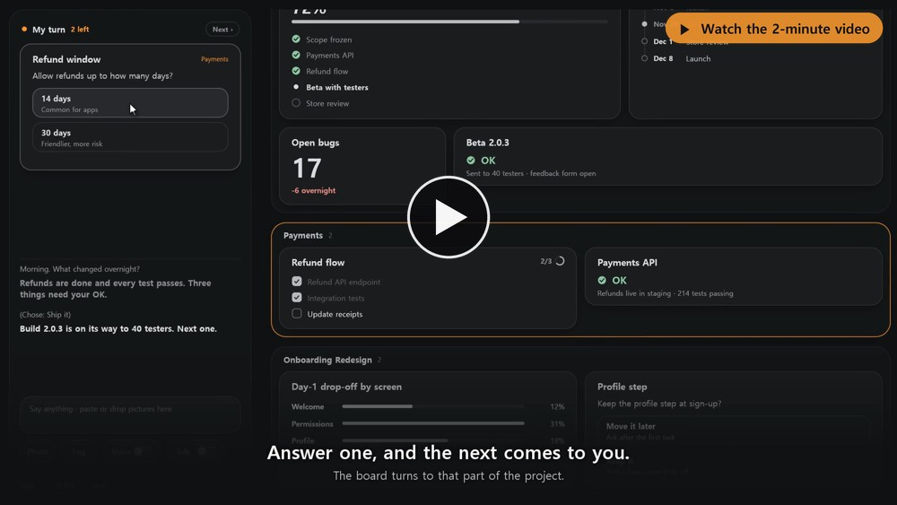
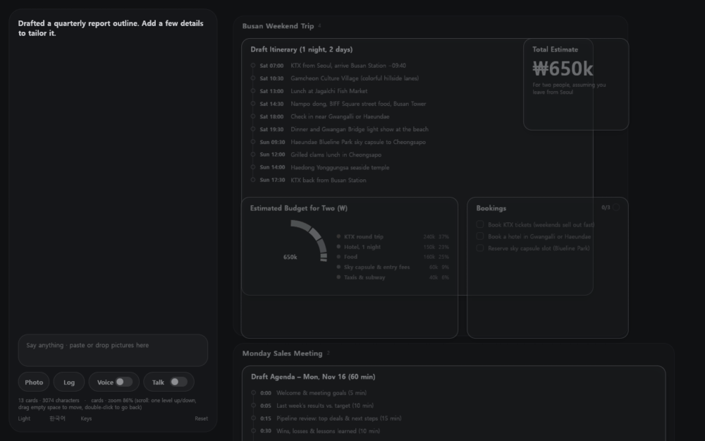
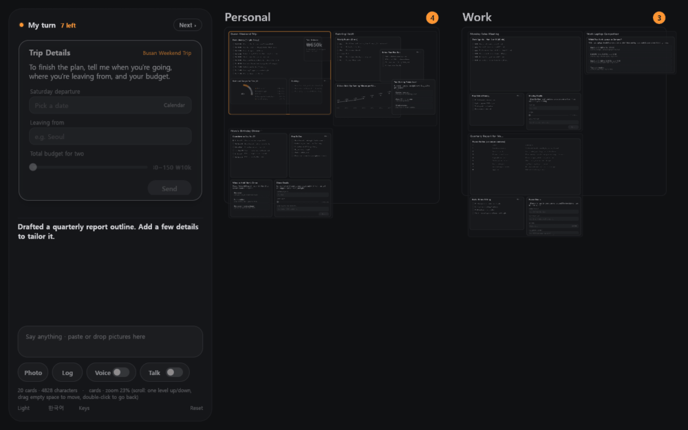
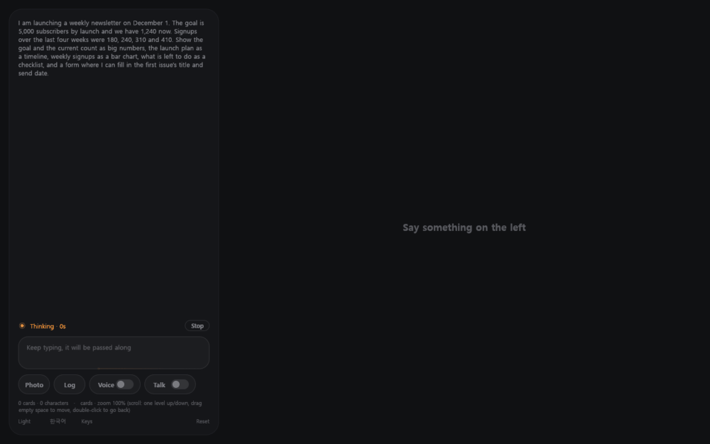
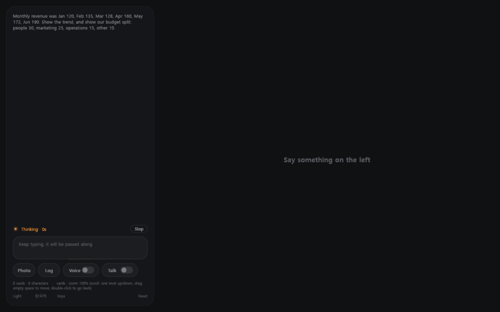

# KITE

**Kinetic Interactive Task Environment** · [English](README.md)

> 글자로 가득 찬 화면은 AI를 쓰는 가장 나쁜 방법이다.

인류는 놀라운 엔진을 발명해 놓고, 그것을 나무 바퀴 달린 마차에 얹었다. 엔진은 AI이고, 마차는 글자로 가득 찬 채팅창이다.

AI의 답은 매번 긴 글로 쏟아진다. 대부분은 읽히지 않는다. 사람끼리 글을 주고받으려고 만든 채팅창이, 글쓰기보다 훨씬 많은 일을 할 수 있는 기계와 일하는 자리가 되어 버렸다.

사람들은 이미 Jira, monday.com, Asana, Notion, Trello 같은 훌륭한 PM 도구와 협업 도구를 수없이 만들었다. 그런데 정작 AI 앞에서는 모두가 다시 글자만 쓰고 있다. 그렇다고 기존의 도구를 AI와의 창구로 쓰기에는 너무 복잡하고, 기능이 너무 넓게 퍼져 있다.

사람들에게 필요한 것은 한곳이다. 모든 대화와 모든 주제가 거기에 있고, 텍스트의 쓰나미 대신 실제로 필요한 정보가 보기 좋게 다듬어져서, 말하는 대로 바뀌는 실시간 적응형 인터페이스.

KITE가 그 한곳이다. 필요한 것을 말하면 AI가 화면을 직접 짠다. 일정은 시간표로, 여행은 경로로, 선택은 눌러서 고르는 카드로 보여 준다.

이름에는 뜻이 두 겹이다. KITE는 **Kinetic Interactive Task Environment**, 말하는 대로 움직이는 작업 공간이다. 다시 읽으면 화면이 지키는 원칙이기도 하다. **Keep Information To Essentials**, 정보를 꼭 필요한 것만 남긴다.

세상에 없던 도구라서 새로 만들었다. 이것으로 모두가 덜 지치고 더 많은 것을 해내기를 바란다.


**2분 영상으로 보기.** 요청 하나가 처음부터 끝까지 흘러가는 모습을 본 뒤, 하나씩 가까이 본다. 내용에 맞게 만들어지는 카드, 긴 프로젝트에서 하나씩 찾아오는 결정, 판을 자유롭게 다루는 모습이다. (영상은 영어 화면이다.)

[](https://github.com/fidenit/KITE/releases/download/v0.3.0/KITE-promo.mp4)

## 무엇이 다른가

**화면이 곧 답이다.** AI는 글을 써 보내지 않는다. 카드가 놓인 판을 한 줄씩 고치고, 사용자는 판이 바뀌는 것을 본다. 같은 일을 다시 물으면 새 글이 쌓이지 않고 그 카드가 바뀐다. 판은 대화 기록이 아니라 지금의 상태다.


**할 일이 나를 찾아온다.** AI가 결정이나 값을 받아야 하면, 그 카드 하나가 대화창 옆의 "내 차례" 자리로 온다. 판은 그 일이 속한 자리로 옮겨 가서 주변 상황을 함께 보여 준다. 답하면 다음 일이 온다. 무엇이 나를 기다리는지 찾아다니지 않는다.


아무 카드나 누르면 그 카드도 같은 자리로 오고, 판에는 같은 주제의 카드만 남는다. 닫으면 판 전체가 돌아온다.



**모든 일이 판 하나에 있다.** 채팅방도 스레드도 없다. 주제들이 한 장의 판에 놓이고, AI가 분류를 만들고 이름을 고치고 합치며 스스로 정리한다. 스크롤 한 번이면 한 단계 위로(카드 → 주제 → 분류), 반대로 한 번이면 가리킨 분류나 주제 안으로 들어간다. 끌면 판이 움직인다. 끝난 일은 보관함으로 내려가고, 다시 말을 꺼내면 돌아온다.



**일마다 맞는 카드.** 큰 숫자, 일정표, 체크리스트, 진행 상황, 표, 차트, 채워 넣는 양식, 경로, 그림, 웹 페이지. 한 주제의 카드가 읽을 수 있는 크기로 다 들어가지 않으면, 글자를 줄이는 대신 덜 중요한 카드를 "+N개 더"로 접어 둔다.



**직접 그린다.** 실제 거리와 소요 시간이 담긴 경로, 꺾은선·막대·도넛 차트, 흐름도와 배치도, 그림. AI가 가장 빨리 읽히는 형태를 고른다.




**기억한다.** 턴이 끝날 때마다 남겨 둘 사실을 골라 적는다. 방금 한 말과 관련 있는 옛 대화는 찾아서 함께 본다. 모든 것은 옵시디언으로 열 수 있는 마크다운 폴더에 남는다.

**일을 한다.** 명령을 실행하고, 파일을 읽고 고치고, 웹을 찾고, 판 위의 브라우저를 다룬다. 보이지 않는 곳에서 도는 자체 브라우저도 있어서, 사이트를 열고 양식을 채우고 단추를 누르다가 로그인이나 캡차처럼 사람이 필요할 때만 화면을 보여 준다. 예약 확정이나 결제 같은 마지막 단추는 사용자가 누르게 남겨 둔다. 오래 걸리는 일은 작업 지시서를 써서 작업자들에게 맡기고, 작업자들이 동시에 일하는 동안 대화는 계속된다.

**말로도 한다.** 타자 대신 말하고 듣는다. AI가 말하는 중에 끼어들 수 있다.

## 빠른 시작

**먼저 둘러보기.** 키가 없으면 준비된 장면을 재생하는 데모로 열리고, 화면에 데모라고 표시된다. 실제로 쓰려면 아래에서 엔진을 고른다.

### Windows: 받아서 실행

1. [Releases](https://github.com/fidenit/KITE/releases)에서 `KITE-0.3.0-windows-x64.zip`을 받는다.
2. 아무 곳에나 푼다.
3. `kite.exe`를 실행한다.

설치는 없다. 처음 켜면 키를 묻는 창이 뜬다. 건너뛰면 데모로 남는다.

### 소스에서 빌드

| | 필요한 것 | 명령 |
|---|---|---|
| Windows | [Rust](https://rustup.rs) `stable-x86_64-pc-windows-gnu`, MinGW([WinLibs](https://winlibs.com)) | `.\run.ps1` |
| macOS | rustup으로 Rust, Xcode 명령줄 도구 | `./run.sh` |
| Linux | 아직 지원하지 않는다(아래 참고) | |

`run.ps1`과 `run.sh`는 빌드해서 바로 실행한다. 뒤에 `test`를 붙이면 테스트, `pack`을 붙이면 들고 다닐 폴더(`portable/KITE`)를 만든다. 자세한 순서와 코드 구조는 [docs/DEVELOPING.md](docs/DEVELOPING.md)에 있다.

Linux: GTK와 WebKit 라이브러리(`glib-sys`)가 없는 컴퓨터에서는 빌드가 거기서 멈춘다. 말하기, 기억 폴더 열기, 전화 도구도 macOS와 Windows 기준으로 짜여 있다. Linux 지원은 열려 있는 숙제다.

### 엔진 고르기

| 엔진 | 필요한 것 | 방법 |
|---|---|---|
| 데모 | 없음 | 키 없이 시작한다 |
| Claude API | [Claude API 키](https://console.anthropic.com/settings/keys). 요금은 본인 계정에 청구된다 | 왼쪽 아래 **키**에 넣거나, 환경 변수 `ANTHROPIC_API_KEY`, 또는 프로그램 옆 `key.txt`에 적는다 |
| Claude Code | [Claude Code](https://claude.com/claude-code)가 깔려 있고 로그인된 상태. API 키는 필요 없다 | 같은 창에서 고르거나, 프로그램 옆 `engine.txt`에 `claude-code`라고 적는다 |

**Claude Code를 엔진으로 쓰기.** KITE는 API를 직접 부르는 대신 턴마다 Claude Code에 맡긴다. Claude Code의 로그인, `CLAUDE.md`, 스킬, 훅, MCP 서버, 권한 설정이 그대로 적용된다. 파일·명령·웹 작업은 Claude Code의 도구로 한다. KITE 자체 도구(경로 지도, 기억 노트, 판 읽기, 작업자)는 KITE 안의 작은 로컬 MCP 서버로 내주고, 작업자와 기억 정리도 Claude Code를 거쳐 돈다. Claude Code가 자기 지시문을 함께 보내기 때문에 API 키 방식보다 턴당 토큰이 더 든다. 기본은 Claude Code에서 허용해 둔 일만 하고, 같은 창에서 파일 수정이나 전부를 허용할 수 있다. `--model sonnet` 같은 Claude Code 옵션은 프로그램 폴더의 `claude-args.txt`에 적는다.

**두 번째 키는 선택이다.** [TypeSafe AI](https://typesafe.ai)의 Jev 키(**키** 창, 또는 `TYPESAFE_API_KEY`). Jev는 글을 쓰지 않고 판단만 하는 작고 빠른 모델이다. 넣으면 말이 어느 주제에 속하는지 미리 고르고, 중요한 카드를 앞에 놓고, 겹치는 주제를 정리하고, 옛 대화에서 필요한 것만 골라 온다. 없어도 KITE는 그대로 동작한다.

키, 판, 기억 보관함은 모두 프로그램 폴더 안에 있다. 폴더를 옮기면 전부 따라간다.

### 엔진으로 쓰기: 프로토콜로 판 채우기

KITE의 화면은 한 줄에 조작 하나인 글줄로 고친다. 이 줄을 쓸 수 있는 것이면 무엇이든 판을 채울 수 있다. 이 언어는 [docs/PROTOCOL.md](docs/PROTOCOL.md)에 적어 두었고(영어), [JSON 스키마](docs/protocol.schema.json)와 바로 불러올 수 있는 [examples/](examples) 판이 있다.

```
topic ws 팀 워크숍
card k2 decision ws 3x3 장소 결정
set k2 text 어디로 할까요?
add k2 o1 강릉 | 멀지만 시설이 좋음
add k2 o2 가평 | 가깝고 저렴함
```

데모에서 예제 판을 불러오는 법(macOS·Linux 셸. PowerShell에서는 먼저 `$env:이름 = "값"`으로 두 변수를 정한다):

```sh
LYBOARD_DEMO=1 LYBOARD_DEMO_SEED=examples/my-turn.ops ./run.sh
```

KITE 0.3.0에는 켜져 있는 동안 줄을 받는 통로가 아직 없다. 그래서 창이 뜨기 전에 불러오거나, 기록 파일 `data/ops.log`로 넣는다. 지금 되는 것과 안 되는 것은 [PROTOCOL.md 11절](docs/PROTOCOL.md)에 있다.

## 실행하기 전에 알아 둘 것

- **AI는 묻지 않고 행동한다.** 사용자의 컴퓨터에서 명령을 실행하고 파일을 고친다. 그렇게 쓰도록 만든 프로그램이다. 그래도 괜찮은 컴퓨터에서, 이 점을 알고 쓴다.
- **쓰는 만큼 돈이 든다.** 기본으로 가장 뛰어난 Claude 모델을 쓴다.
- **아직 초기다.** 한 사람이 매일 쓰고 있다. 한국어와 영어를 지원하고, 화면 구석에서 바꾼다. [다음에 할 일](docs/NEXT.md)을 본다.
- 경로 카드의 거리와 시간은 카카오맵에서 읽어 온다. 그래서 경로는 한국 안에서 동작한다.

## 개발자에게

Rust와 [egui](https://github.com/emilk/egui)로 만들었고, Claude API를 HTTP로 직접 부른다. 웹 화면은 없다. 모델은 판을 고치는 작은 줄 단위 언어를 내고, 줄이 도착하는 대로 반영된다. 그 판을 같은 언어로 다시 적은 것이 다음 턴에 모델이 보는 전부다.

이 언어는 [docs/PROTOCOL.md](docs/PROTOCOL.md)(KITE Board Protocol v0.1, 영어)에 적어 두었고, [protocol.schema.json](docs/protocol.schema.json)과 [예제](examples)가 있다. 빌드 방법, 코드의 구조, 새 카드 종류를 더하는 법은 [docs/DEVELOPING.md](docs/DEVELOPING.md)에 있다.

코드의 대부분은 AI(Claude)와 함께 썼다. 구상과 설계의 결정은 사람이 했다.

## 라이선스

[Apache License 2.0](LICENSE). 다시 배포할 때는 [NOTICE](NOTICE) 파일을 함께 둔다. "KITE"라는 이름은 파생 제품의 이름으로 쓸 수 없다.

---

**FIDENIT** · 세상을 위해.
